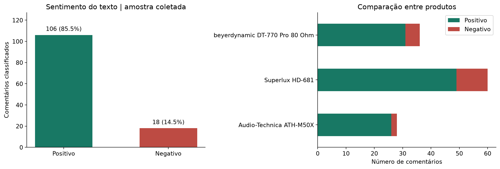

# Análise de sentimentos em e-commerce — português

Web scraping com BeautifulSoup e análise de avaliações originais em português da
**Thomann Portuguesa**, usando o classificador lexical **LeIA**.

## Resultados da coleta de 03/11/2026

- 140 avaliações extraídas de 16 páginas sobre três fones.
- 16 excluídas na verificação adicional de idioma.
- **124 comentários analisados:** 106 classificados como positivos e 18 como negativos.
- 7 casos de baixa polaridade sinalizados para revisão.



**Os percentuais descrevem a classificação automática.** Há erros lexicais demonstrados
no relatório e a concordância com estrelas é inferior à referência de prever sempre
positivo. As estrelas são rótulos fracos, com forte desbalanceamento, e não houve
validação por anotadores humanos. Não interprete estes números como taxa de insatisfação.

## Entregas

- [Notebook com código e saídas executadas](Analise_Sentimentos_Ecommerce.ipynb)
- [Relatório em Markdown](resultados/RELATORIO.md)
- [Relatório HTML autossuficiente](resultados/RELATORIO.html): baixe e abra no navegador.
- [Comentários classificados](dados/avaliacoes_classificadas.csv)
- [Auditoria do idioma](dados/auditoria_idioma.csv)
- [Manifesto das páginas, horários e hashes](dados/manifesto.json)

## Reprodução

Python 3.13, em um ambiente virtual, na raiz do projeto:

```bash
python -m pip install -r requirements.txt
python verificar.py
python analise.py
python gerar_entrega.py
```

O notebook também pode ser aberto pelo VS Code ou Jupyter. Preserve as pastas `dados`,
`vendor` e `resultados` ao copiar o projeto. Com o cache incluído, a extração e a análise
funcionam sem acessar a loja. O gerador executa o notebook, refaz gráficos e relatórios,
e cria um ZIP de entrega ao lado da pasta do projeto. Para nova coleta, use uma cópia
sem a pasta `dados/html`, preservando o snapshot entregue.

## Método

Filtro do site `reviewlang[]=6`, ordenação `order=latest`, até dez páginas por produto,
parada em página incompleta, pausa de 1,5 s e interrupção em falha HTTP. A verificação
adicional exige `pt` pelo langdetect (semente 0 e escore >= 0,8). A triagem pode excluir
textos curtos genuinamente em português.

O LeIA analisa título e comentário; as estrelas não são usadas para classificar.
Saída binária: compound >= 0 é positivo e < 0 é negativo. |compound| < 0,05 é
sinalizado. O escore não é uma probabilidade. Veja no notebook a correção explícita
da entrada lexical `nao`, verificada com testes de negação.

## Estrutura

- `analise.py`: coleta, extração, idioma, classificação e agregações.
- `verificar.py`: verificações locais do extrator, negações e idioma.
- `gerar_entrega.py`: gráficos, notebook executado e relatórios.
- `dados/html`: páginas e metadados da coleta; arquivos públicos podem conter nomes
  dos autores, embora esses nomes não sejam exportados aos CSVs.
- `vendor`: LeIA e léxicos, com licença MIT, commit de origem e adaptações documentadas.

## Fontes e licenças

- [Thomann Portuguesa](https://www.thomann.pt/): URLs específicas no manifesto.
- [LeIA — Rafael J. A. Almeida, 2018](https://github.com/rafjaa/LeIA): licença MIT e
  origem em `vendor/ORIGEM.md`. Dois `open()` receberam encoding UTF-8 explícito.
- [BeautifulSoup](https://www.crummy.com/software/BeautifulSoup/bs4/doc/)
- [langdetect](https://pypi.org/project/langdetect/)

Os dados e comentários continuam sujeitos aos direitos de seus autores e da fonte;
a licença do LeIA não licencia as avaliações. Este trabalho é um estudo didático,
sem vínculo com a loja ou os fabricantes. Os materiais da atividade foram usados
como referência; não se copiou seu exemplo de treinamento supervisionado.
