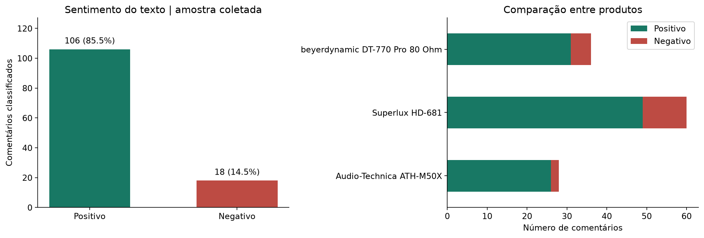
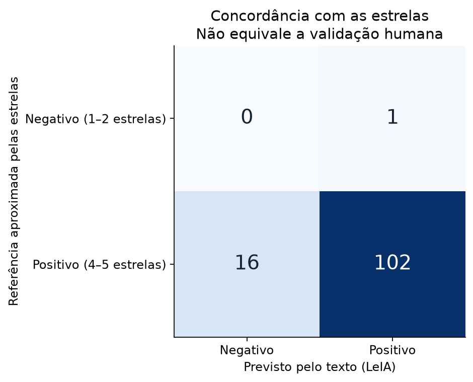
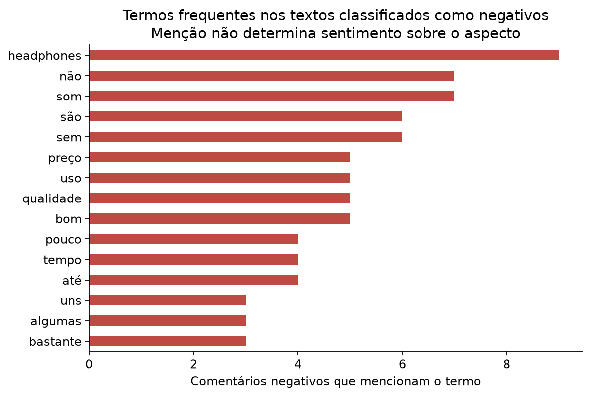

# Web scraping e análise de sentimentos em produtos de e-commerce

**Instituição:** Católica de Santa Catarina

**Disciplina:** Ciência de Dados

**Professor:** Claudinei Dias (Ney)

**Integrantes:** André Schultz; José Henrique Brühmüller; Lucas Monich Nunes; Matheus Büsemayer.

**Loja:** Thomann Portuguesa | **Coleta:** 03/11/2026 (America/Sao_Paulo)
**Datas dos comentários na amostra:** 20/01/2016 a 15/09/2026.

## Objetivo
Coletar produtos e seus comentários em um e-commerce, classificar o sentimento em Positivo/Negativo e apresentar resultados e insights verificáveis.

## Método
Foram escolhidos três fones da Thomann Portuguesa: Superlux HD-681, Audio-Technica
ATH-M50X e beyerdynamic DT-770 Pro 80 Ohm. Coletaram-se as páginas disponíveis no filtro
português (reviewlang[]=6), ordenadas por data (order=latest), com limite de dez páginas
por produto e parada na última página incompleta. Há 67, 31 e 42 avaliações brutas,
respectivamente, totalizando 140 em 16 páginas HTML. São avaliações originais, sem tradução.

A extração usa requests e BeautifulSoup, intervalo de 1,5 s entre downloads, cache,
URLs, horários e hashes SHA-256. Reexecuções usam os HTMLs incluídos, sem novos downloads.
Não há login, APIs internas nem contorno de bloqueios.

O filtro do site também retornou textos em inglês. Por isso, além do atributo pt no HTML,
exigiu-se identificação pt pelo langdetect com valor >= 0,8 e semente fixa 0. Este valor é um
escore interno do detector, sem calibração como garantia de idioma. A regra conservadora
pode excluir comentários curtos em português. As decisões estão em dados/auditoria_idioma.csv.
Removeram-se espaços repetidos, vazios e duplicatas por produto/ID ou texto normalizado.

O sentimento é calculado pelo LeIA (Léxico para Inferência Adaptada), adaptação do VADER
ao português. Não se treinou um classificador supervisionado. Foram fixados o código,
os léxicos e a licença MIT do LeIA na pasta vendor, com referência ao commit original.
Há uma correção explícita na integração: a entrada lexical nao (-1,2) foi removida para
permitir sua atuação como operador de negação. Antes disso, a frase de teste com som não bom
recebia resultado positivo. Testes cobrem essa regressão e a leitura dos arquivos em UTF-8.
As demais regras do LeIA foram preservadas. A correção não elimina outras limitações do modelo.

O título e o comentário alimentam o modelo; estrelas nunca são entrada. O texto com acentos
fica preservado no CSV, embora o LeIA normalize acentos internamente. Preservam-se caixa,
pontuação e negações na entrada. O compound varia entre -1 e +1 e não é uma probabilidade.

Para a saída binária solicitada, compound >= 0 é Positivo e compound < 0 é Negativo.
Resultados com |compound| < 0,05 são sinalizados como baixa polaridade, incluindo zero,
atribuído a Positivo por convenção. Não são evidência firme de satisfação.

Na comparação auxiliar, 4–5 estrelas são referência positiva e 1–2, negativa. Três estrelas
ficam fora da comparação. Esses rótulos são fracos: notas e tom do texto podem divergir.
A matriz mede concordância com as estrelas e não acurácia validada por anotadores humanos.
O léxico também falha em expressões, negações complexas e termos técnicos de áudio.

## Resultados por produto
```text
                                avaliacoes  positivos  negativos  nota_media  score_medio  percentual_positivo
produto                                                                                                       
Audio-Technica ATH-M50X                 28         26          2       4.929        0.561               92.857
Superlux HD-681                         60         49         11       4.517        0.442               81.667
beyerdynamic DT-770 Pro 80 Ohm          36         31          5       4.917        0.530               86.111
```





## Temas mencionados
```text
                     tema  comentarios_com_mencao  em_textos_negativos
                      Som                      95                   10
                 Conforto                      66                    9
Construção e durabilidade                      27                    4
            Preço e valor                      55                    6
```



## Insights e limitações
A amostra contém **124 comentários válidos**, sendo **106 positivos
(85.5%)** e **18 negativos (14.5%)**. Foram excluídos
16 registros pelo critério adicional de idioma; a base bruta tem 140 registros. Há 7 textos de baixa polaridade.

O maior percentual positivo observado foi o de **Audio-Technica ATH-M50X**
(92.9%, n=28).
Esse resultado descreve a janela coletada; não demonstra superioridade do produto.
O número de comentários e o período coberto devem acompanhar qualquer comparação.

Na referência de 119 avaliações de 1–2 ou 4–5 estrelas,
a concordância foi **85.7%**, com 17 divergências.
Quantidade de referências negativas nessa comparação: 1;
o desbalanceamento exige examinar a matriz e impede tratar a concordância global como prova de qualidade.

A leitura exploratória dos comentários 4508250 e 4336883 do Superlux mostra elogios ao som
acompanhados de desconforto depois de horas de uso, mesmo com quatro estrelas.
No ATH-M50X, o comentário 4955954 também cita o peso como limitador do tempo de uso.
São exemplos que sugerem investigar ergonomia e duração das sessões, sem medir a
prevalência de cada problema na população de compradores.

Há falsos negativos plausíveis: o comentário 3505487 elogia a definição das frequências
graves, mas o classificador retorna negativo. O léxico pode interpretar termos técnicos
como palavras de polaridade. Já o 2730701 recomenda o produto e nega haver aspectos
negativos, mas também recebe classificação negativa. Esses casos mostram que os
percentuais calculados não devem ser usados diretamente como taxa de insatisfação.

Como referência de desbalanceamento, prever sempre Positivo concordaria com
99.2% das estrelas elegíveis.
Essa referência supera a concordância do LeIA nesta amostra; o modelo lexical não está
validado para decisões sobre reclamações. A presença de apenas uma referência negativa
também impede conclusões robustas sobre sua capacidade de reconhecer insatisfação.

As tabelas de temas e termos ajudam a priorizar a leitura: som, conforto, construção/durabilidade
e preço podem aparecer tanto em elogios quanto em reclamações. As contagens de menções não são
uma análise de sentimento por aspecto e os temas podem se sobrepor.

Como ação prática, recomenda-se revisar primeiro as divergências com as estrelas e os textos de
baixa polaridade. Depois, categorizar manualmente as reclamações de conforto, peso e construção
antes de propor melhorias, devoluções ou mudanças na descrição do produto.

Esta é uma amostra por conveniência, limitada ao português e às páginas disponíveis no momento.
Não é uma estimativa representativa de todos os compradores, das vendas ou do mercado.
Comentários de várias datas podem aparecer nas páginas mais recentes; não há inferência causal.
Uma evolução seria construir uma amostra anotada por duas pessoas e medir precisão, recall e F1
por classe em dados independentes, comparando LeIA com Naive Bayes ou outro modelo.

## Fontes
- Loja e páginas de avaliações: https://www.thomann.pt/superlux_hd681_reviews.htm ; https://www.thomann.pt/audio_technica_ath_m50_x_reviews.htm ; https://www.thomann.pt/beyerdynamic_dt770_pro80_ohm_reviews.htm
- Regras consultadas: https://www.thomann.pt/robots.txt (cópia na pasta dados/html).
- LeIA: Rafael J. A. Almeida (2018). https://github.com/rafjaa/LeIA (commit fixado em vendor/ORIGEM.md).
- VADER, base original do LeIA: Hutto, C. J.; Gilbert, E. (2014). *VADER: A Parsimonious Rule-based Model for Sentiment Analysis of Social Media Text*. ICWSM. https://github.com/cjhutto/vaderSentiment
- langdetect: https://pypi.org/project/langdetect/
- BeautifulSoup: https://www.crummy.com/software/BeautifulSoup/bs4/doc/
- Material de apoio fornecido: “Aula 05 — Data Scraping com BeautifulSoup”, Renato Vimieiro (2017), e “Análise de sentimentos — Utilizando Python para construir e treinar modelos de machine learning”, Wheslley Rimar Bezerra. Foram usados como referências didáticas; os exercícios e procedimentos do material não substituem o pedido do usuário. Aqui foi escolhida uma abordagem lexical, com avaliação auxiliar por estrelas, em vez de reproduzir o treino supervisionado do PDF.
